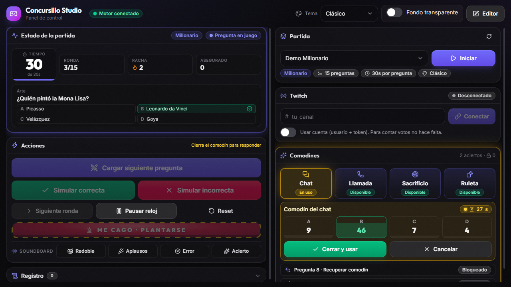
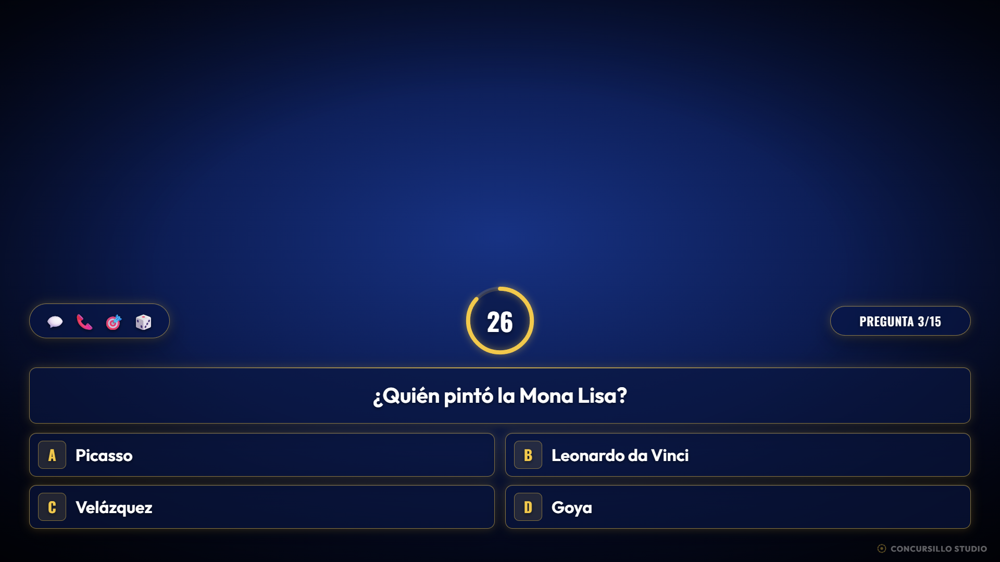
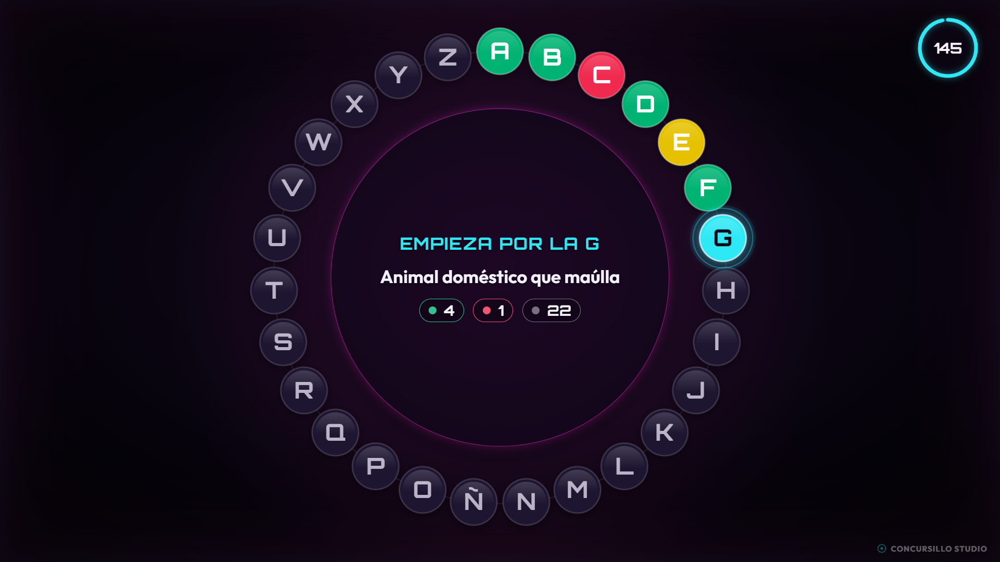

<div align="center">

# 🎙️ Concursillo Studio

**Monta tu propio concurso de televisión en directo.**
Millonario y El Rosco con overlays para OBS, votaciones del chat de Twitch y un panel de control pensado para streamers.

[](LICENSE)
[](https://v2.tauri.app/)
[](https://www.rust-lang.org/)
[](https://react.dev/)
[](https://www.typescriptlang.org/)
[](https://github.com/SRGarciaVel/concursillo-studio/releases)

[Descargar](https://github.com/SRGarciaVel/concursillo-studio/releases/latest) · [Guía de usuario](docs/GUIA_USUARIO.md) · [Arquitectura](docs/ARQUITECTURA.md) · [Roadmap](docs/ROADMAP.md)

</div>

---

## 📸 Screenshots

<p align="center">
  
</p>
<p align="center"><em>Panel de Control: partida, comodines, soundboard, Twitch y presets en una sola pantalla.</em></p>

<table>
  <tr>
    <td width="50%"></td>
    <td width="50%"></td>
  </tr>
  <tr>
    <td align="center"><em>Stage · Millonario (tema Clásico)</em></td>
    <td align="center"><em>Stage · El Rosco</em></td>
  </tr>
</table>

## ✨ Características principales

- 🎮 **Dos modos de juego: Millonario y El Rosco.** Escalera de 15 preguntas con niveles asegurados y opción de plantarse, o rosco de 27 letras (A–Z + Ñ) con pasapalabra y reloj global.
- 📺 **Integración nativa con OBS.** El Stage se añade como fuente de navegador y tiene un **fondo transparente** de un clic para superponerlo sobre tu gameplay o tu webcam.
- 💬 **Comodín del chat en tiempo real con Twitch.** Los espectadores votan A/B/C/D y las barras se mueven en directo (un voto por persona).
- 🎨 **Sistema de temas (Clásico, Neón, Default)** con fuentes propias (Oswald, Orbitron, Outfit) incluidas en la app, sin depender de internet.
- 🎵 **Gestor de sonidos y Soundboard integrado.** Sustituye cualquier efecto desde el Editor y lánzalo desde el Control sin recargar OBS.
- 🚀 **Presets.** Guarda y carga la configuración completa de tu programa (preguntas, tema, tiempo y canal de Twitch) con un clic.

Y además: comodines de Llamada, Sacrificio y Ruleta, hitos en las preguntas 8 y 11, importación masiva de preguntas desde TXT/CSV/Excel y animaciones que respetan *reducir movimiento*.

## 🚀 Instalación Rápida

1. Ve a **[Releases](https://github.com/SRGarciaVel/concursillo-studio/releases/latest)** y descarga `Concursillo Studio_<versión>_x64-setup.exe`.
2. Ejecuta el instalador. Si **Windows SmartScreen** muestra un aviso, pulsa **Más información → Ejecutar de todas formas**. Aparece porque el instalador todavía no está firmado digitalmente.
3. Abre **Concursillo Studio**: se abren el **Control** y el **Editor**, con un preset de ejemplo listo para jugar.
4. En **OBS**, añade una fuente **Navegador** con la URL `http://127.0.0.1:4322/stage/` a **1920×1080**.

Todo el detalle (preguntas, Twitch, sonidos y problemas frecuentes) está en la **[Guía de usuario](docs/GUIA_USUARIO.md)**.

## 🛠️ Desarrollo (Build from source)

**Requisitos:** [Rust](https://rustup.rs/) estable, [Node.js](https://nodejs.org/) 20+, [pnpm](https://pnpm.io/) y WebView2 (ya viene con Windows 10/11).

```bash
git clone https://github.com/SRGarciaVel/concursillo-studio.git
cd concursillo-studio
pnpm install
```

Modo desarrollo (servidores de Vite y la app en otra terminal):

```bash
pnpm dev
```

```bash
cd src-tauri && cargo run
```

Compilar los instaladores (se generan en `src-tauri/target/release/bundle/`):

```bash
pnpm tauri:build
```

Comprobaciones antes de cada cambio: `cargo test` (en `src-tauri/`) y `pnpm typecheck`. La estructura del proyecto y cómo añadir temas, comodines o comandos están en **[docs/ARQUITECTURA.md](docs/ARQUITECTURA.md)**.

## 📄 Licencia

Distribuido bajo la licencia **MIT**. Consulta el archivo [LICENSE](LICENSE).

**Créditos**

- Creado por **[SRGarciaVel](https://github.com/SRGarciaVel)**.
- Concepto inspirado por **IlloJuan** y su *Concursillo*.
